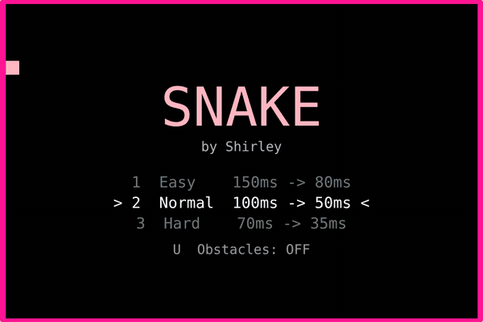

# 贪吃蛇 Snake

[English](README.en.md)

**在线试玩：** https://yiyishirley.github.io/game_snake/

一个从 C++ / EasyX 桌面游戏起步、后来移植到网页的贪吃蛇。粉色像素风，吃食物时有粒子爆开和屏幕抖动，越吃越快，还可以按 `T` 让 AI 接手自动玩。

## 功能

- **三档难度**：Easy / Normal / Hard，起步速度分别是 150 / 100 / 70ms 一步，每吃一个快 3ms
- **障碍物模式**：随机生成墙块，开局时在菜单按 `U` 开关
- **AI 自动玩**：BFS 寻路 + 安全检查，能把 33×22 的棋盘吃满（见下文）
- **AI 思路可视化**：按 `V` 实时显示 AI 的 BFS 搜索范围和选中的路线；判断吃食物会把自己困住时，会显示被否决的路线，并改成追尾巴
- **特殊食物**：金色食物限时出现，吃到 +50 分；蓝色食物让蛇减速
- **连击**：短时间内连续吃到食物，分数最多 ×4
- **成绩分享图**：Game Over 后一键生成带分数和最终棋盘的竖版图片
- **数据统计**：总局数、平均分、最高连击、游戏时长、死因分布（撞墙 / 撞自己 / 撞障碍）
- **最高分和本机排行榜**：网页版存在浏览器 localStorage，C++ 版存在 `highscore.txt`；开过 AI 的局不计分
- **原版音乐**：背景音乐和 Game Over 音效
- **操作**：WASD 或方向键，大写锁定也能用；手机上可以滑动屏幕转向；切到别的标签页时自动暂停
- **中英文切换**：右上角一键切换，默认跟随浏览器语言，会记住你的选择
- **通关判定**：吃满全屏显示 You Win

## 操作

| 按键 | 作用 |
|---|---|
| `W A S D` / 方向键 | 移动 |
| `Space` | 暂停 / 继续 |
| `T` | 开关 AI 自动玩 |
| `V` | 显示 AI 思路（网页版） |
| `Enter` | 开始 / Game Over 后重开 |
| `1` `2` `3`、`U` | 菜单里选难度、开关障碍物（网页版） |
| `Esc` | 回菜单（网页版）/ 退出（C++ 版） |

## 项目经历

| 版本 | 时间 | 内容 |
|---|---|---|
| v1 | 2024.04 | C++ + EasyX 写出基础版：方格地图、渐细的蛇身、食物弹出动画、屏幕抖动、粒子、分数 |
| v1.1 | 2024.06 | 加入最高分、暂停、背景音乐和结束音效；用 Visual Studio 打包成 Windows 安装包 |
| v2 | 2026.10 | 修复一批 bug，重构命名；移植到网页（HTML5 Canvas）；加入难度、障碍物、AI 自动玩、排行榜、手机操作 |
| v2.1 | 2026.10 | 网页版加入 AI 思路可视化、特殊食物、连击、成绩分享图、数据统计、吃食物音效 |

原始代码保留在 [`original/`](original/)，v2 的 C++ 版在 [`cpp-easyx/`](cpp-easyx/)，网页版就是根目录的 `index.html`。

## v2 修了哪些问题

| 问题 | 原因 | 修法 |
|---|---|---|
| 追着自己尾巴走会被判死 | 撞身体检测把尾巴刚离开的格子也算进去了（`i < snack_len + 1`） | 这一步不吃食物时，尾巴那格不参与碰撞检测 |
| 运行时 CPU 占满一个核 | 主循环、暂停、Game Over 都是空转，没有 `Sleep` | 每帧 `Sleep(4)` + `timeBeginPeriod(1)`，约 200fps |
| 快速连按转向会丢键、慢半拍 | 每走一步才读一个按键 | 每帧读完所有按键，最多缓存 2 次转向，并过滤 180° 掉头 |
| 吃满全屏会卡死 | 生成食物用 `goto` 随机重试，没有空位就无限循环 | 先收集所有空格子再随机选；没有空格就判定通关 |
| 开大写锁定或用方向键就控制不了 | `_getch()` 只认小写 `wasd` | 统一转小写，并处理方向键的双字节码（224 + 72/80/75/77） |
| Game Over 文字超出屏幕 | 字号每个字 50px 宽，40 个字符 = 2000px > 1080px | 改用自然字宽，按屏幕宽度自适应 |
| Game Over 画面一直抖 | Game Over 循环里每帧把抖动计数清零 | 只在进入 Game Over 时抖一次 |
| 粒子永远不消失 | 粒子没有生命周期，掉出屏幕后还在每帧计算 | 加生命值，超时或掉出屏幕就删除 |
| 速度固定不变 | `#define GAMETIME 100` 是常量 | 改成变量，每吃一个快 3ms，有最快上限，重开时重置 |
| 命名不规范 | `snack`（零食）、`gameupdata`、`gamedrawpixal`、`lizi` | 改为 `snake`、`gameUpdate`、`drawCell`、`particle` 等 |

## AI 是怎么玩的

每走一步之前：

1. 用 **BFS** 找蛇头到食物的最短路径。
2. 在脑子里模拟沿这条路吃到食物之后的蛇身，再用 BFS 检查**新蛇头还能不能走到自己的尾巴**。能走到，说明吃完不会把自己困死，就走这条路。
3. 不安全或找不到路时，在四个方向里选一个不会撞的，优先选**还能追到尾巴**的、**周围空间最大**（洪水填充计数）的方向，先绕圈等待机会。
4. 如果绕了太久都没吃到食物，就加一点随机性打破死循环。

在网页版里按 `V` 可以直接看到这个过程：淡蓝色格子是 BFS 搜过的范围，蓝线是安全的去食物路线，红色虚线是被否决的路线（吃了会困死），黄线是改去追尾巴的路线。

测试中，空棋盘上跑了 3 局，AI 有 2 局把 726 格全部吃满。

## 运行

**网页版**：直接用浏览器打开 `index.html`。部署到 GitHub Pages：仓库 Settings → Pages → Source 选 `main` 分支根目录。

**C++ 版**（Windows + Visual Studio + [EasyX](https://easyx.cn)）：

1. 新建空项目，把 `cpp-easyx/` 里的 `main.cpp`、`main.h`、`snake.rc` 和两个 `.wav` 加进去
2. 选择 **Release / x64** 编译运行
3. 音效作为资源编译进 exe，不依赖外部文件；`winmm.lib` 已在代码里用 `#pragma comment` 链接

## 开发说明

v1 由我独立用 C++ 完成。v2 的移植和重构使用了 AI 辅助编程（Claude）。我负责需求、测试、找 bug 和确定方案，AI 协助写代码。
